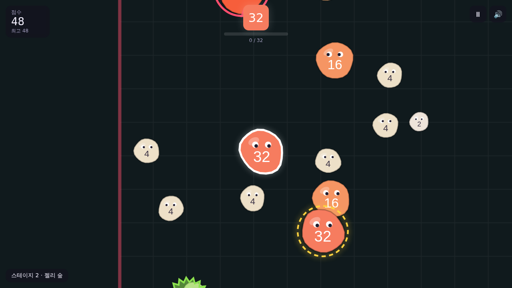
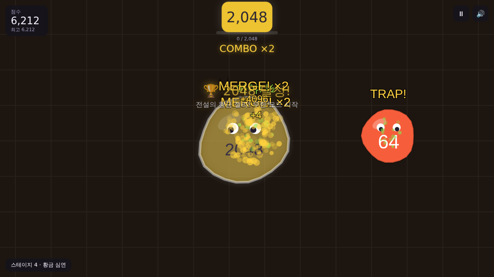
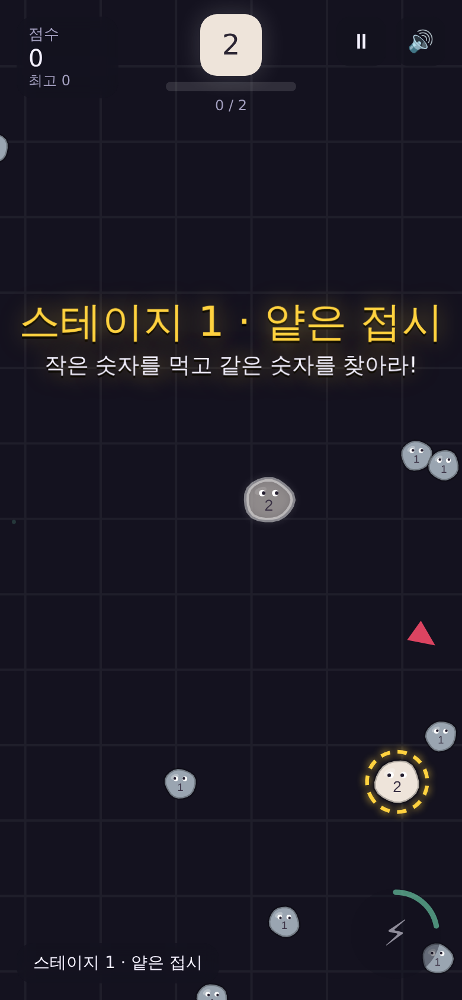

# 05. QA 검증 보고서 (QA)

## 1. 테스트 구성
| 종류 | 파일 | 내용 |
|---|---|---|
| 로직 단위 테스트 | `tests/logic.test.js` | 먹기/잭팟/가시/콤보/스폰/속도 규칙 + **밸런스 시뮬레이션** |
| 브라우저 E2E | `tests/e2e.js` | 실제 Chromium에서 게임 실행, 입력 검증, **자동 봇이 60초 직접 플레이**, 모바일 뷰포트 검증, 스크린샷 |

실행 방법
```bash
npm test          # 로직 단위 테스트 (Node 18+)
npm run test:e2e  # 브라우저 QA (Playwright 필요)
```

## 2. 결과 요약
- 로직 테스트: **10 / 10 통과**
- 브라우저 E2E: **25 / 25 통과** (콘솔 에러 0)

| 영역 | 검증 항목 | 결과 |
|---|---|---|
| 흐름 | 타이틀 → 플레이 → 게임오버 → 재시작, 일시정지/해제 | ✅ |
| 조작 | 마우스 방향 이동, 키보드 이동, Space/클릭 대시 + 쿨다운 | ✅ |
| 규칙 | 같은 숫자 즉시 ×2, 큰 젤리 접촉 시 사망, 가시 반토막(생존), TRAP | ✅ |
| 목표 | 2048 달성 시 클리어 배너 → 무한 모드 지속 | ✅ |
| 저장 | 최고 점수/최고 숫자 localStorage 저장 (차단 환경에서도 에러 없음) | ✅ |
| 모바일 | 390×844 터치: 대시 버튼 노출·동작, 터치 방향 이동, 가로 스크롤 없음 | ✅ |
| 봇 플레이 | 60초 동안 사망 없이 128까지 성장, 잭팟 합체 6회 | ✅ |

## 3. 발견 이슈 & 조치 (QA → 기획/개발 피드백 루프)
| # | 심각도 | 이슈 | 원인 | 조치 |
|---|---|---|---|---|
| 1 | 높음(재미) | 2048까지 너무 빨리 도달 (최선 플레이 시 약 15회 먹기) | 잭팟 스폰 가중치 1.6이 과다 | 잭팟 1.0, 직하위 2.2로 하향 → 최선 17회 / 일반 32회 (3~5분) |
| 2 | 높음(재미) | 화면이 휑함 — 화면당 젤리 2~3마리, 봇이 45초간 2회만 먹음 | 월드 4000px에 80마리는 밀도 부족 | 월드 3000px, 150마리로 상향 → 같은 봇이 60초 생존하며 128 도달 |
| 3 | 낮음 | 외부 폰트 차단 시 콘솔 에러 | 오프라인/차단 환경 | 시스템 폰트 폴백 확인, 테스트에서 폰트 요청 제외 |

## 4. 재미 관점 체크 (수동 관찰)
- 잭팟(금색 점선) 젤리가 도망가는 걸 대시로 낚아챌 때 쾌감이 확실함
- 빨간 링 + 화난 눈썹 덕분에 위협 식별이 즉각적. 화면 밖 추격자는 가장자리 빨간 화살표로 표시돼 "억울한 죽음"이 적음
- 스테이지 2(32)부터 가시가 등장하며 "피하기 → 유인하기"로 플레이 양상이 바뀜

## 5. 남은 개선 후보 (다음 버전)
- 실시간 멀티플레이 / 온라인 랭킹
- 효과음 볼륨 조절, 색약 모드 추가 옵션
- 젤리끼리 서로 잡아먹는 생태계(현재는 플레이어 중심 상호작용만)

## 6. 스크린샷
| 타이틀 | 플레이 | 2048 달성 | 모바일 |
|---|---|---|---|
|  |  |  |  |
